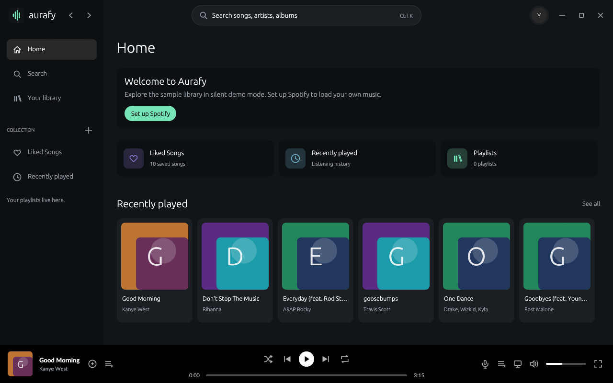

# Aurafy

Aurafy is an open-source Windows desktop client for Spotify, built with Rust and egui. Browse your library, edit playlists you own, follow synced lyrics, and switch playback between this PC and your other Spotify Connect devices.

**[Download Aurafy 0.8.0 for Windows x64](https://gitlab.com/aurafy-project1/aurafy-downloads/-/raw/main/Aurafy-0.8.0-Windows-x64.zip)** · [First-run guide](FIRST_RUN.md) · [Report a problem](https://github.com/Joson69/Aurafy/issues/new/choose)



## Get started

1. Extract the ZIP and run `aurafy.exe`. You can explore the interface with sample data before connecting Spotify. Demo mode is silent.
2. To load your library, create a Spotify Web API app with your Premium account. Follow the [first-run guide](FIRST_RUN.md) to register two redirect URLs and paste your Client ID into Aurafy.
3. To hear music on this PC, generate a personal Spotify Soloist API key and pair Aurafy from Spotify. You can also control an existing Spotify Connect device with Premium.

Spotify's [Development Mode](https://developer.spotify.com/documentation/web-api/concepts/quota-modes) limits each new Web API app to five authorized accounts. Spotify requires each person setting up [Soloist](https://developer.spotify.com/documentation/soloist) to generate their own key. Aurafy downloads the official engine when needed. Spotify sign-in uses your default browser, and Windows Credential Manager stores the refresh token and Soloist key.

## What you can do

- **Play and switch devices.** Play on this PC with Soloist or hand off to your phone or another Spotify Connect device. The Windows tray keeps your controls within reach.
- **Work with your library.** Search Spotify, browse albums and artists, save songs, queue tracks, and filter and remove multiple songs from your own playlists.
- **Pick up where you left off.** Open your recently played tracks and top artists or tracks, and choose whether Aurafy resumes playback when it opens.
- **Make it yours.** Choose a theme, adjust interface zoom, follow synced lyrics, or set a sleep timer. Lyrics come from [LRCLIB](https://lrclib.net/docs) when you open the lyrics view.

## Build and contribute

Install [Rust stable](https://rustup.rs/) (1.90 or later) with the Windows MSVC build tools. From the repository root:

```powershell
cargo run --locked
cargo test --locked
cargo build --release --locked
```

The release executable is `target/release/aurafy.exe`. The [Windows build workflow](https://github.com/Joson69/Aurafy/actions/workflows/build-windows.yml) also builds an x64 executable as a temporary Actions artifact. The project pins eframe and egui to 0.33.3 because 0.34 changes the UI entry point.

If a setup step fails, [open an issue](https://github.com/Joson69/Aurafy/issues/new/choose) with your Aurafy version, Windows version, and the step and error you saw. Keep your Spotify credentials and sign-in callback URLs private.

[Changelog](PATCH_NOTES.md) · [Settings reference](SETTINGS_FEATURES.md) · [MIT license](LICENSE) · [Third-party notices](THIRD_PARTY_NOTICES.md)

Aurafy is an independent project. Spotify is a trademark of Spotify AB.

## Performance design

- Rust + egui native rendering instead of Electron/Chromium.
- Release profile uses size optimization, LTO, one codegen unit, and symbol stripping.
- UI idles at a low repaint rate; playback progress updates at 10 FPS by default. Settings → Appearance offers an optional 30 FPS mode.
- Network work is kept off the UI thread.
- Spotify API requests share an HTTP connection pool. Credential Manager is updated when the refresh token changes, rather than on every player poll.
- Artwork shares the HTTP connection pool and downloads are bounded before decoding. Queue API polling stops while the queue is hidden.
- Search results and long track lists use virtualized scrolling.
- Artwork requests are size-capped, limited to four concurrent downloads, decoded off-thread, resized to 256 × 256, and limited to a 72-texture in-memory cache.
- No JavaScript runtime or web view is used. Optional local playback uses Spotify's native engine, a loopback-only WebSocket, and a 100 MB audio cache cap.

RAM and frame time depend on the system, driver, display scaling, and number of visible artwork textures. No benchmark figures are claimed until measured on a real Windows machine.
